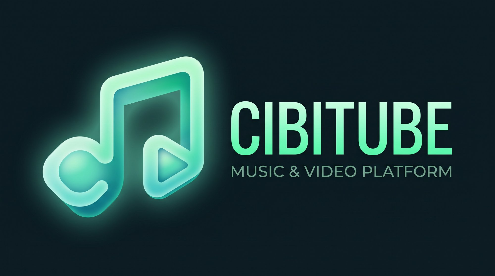

<p align="center">
  
</p>

<p align="center">
  <a href="https://www.rust-lang.org/">
    
  </a>
  <a href="https://github.com/emilk/egui">
    
  </a>
  <a href="https://mpv.io/">
    
  </a>
  <a href="https://github.com/Cibitka/Cibitube/releases">
    
  </a>
  <a href="https://github.com/Cibitka/Cibitube/releases/latest">
    
  </a>
  <a href="https://boosty.to/zch_cibitka/donate">
    
  </a>
  <a href="LICENSE">
    
  </a>
</p>

<p align="center">
  <b>English</b> &nbsp;•&nbsp; <a href="README.ru.md"><b>🇷🇺 Документация на русском языке (README.ru.md)</b></a> &nbsp;•&nbsp; <a href="docs/GOOGLE_DRIVE_SYNC_SETUP.md"><b>☁️ Google Drive Sync Guide</b></a> &nbsp;•&nbsp; <a href="https://github.com/Cibitka/Cibitube/releases/latest"><b>📥 Releases</b></a>
</p>

---

# Cibitube — Native YouTube Music Desktop Client

**Cibitube** is an ultra-fast, lightweight native YouTube Music client written in pure **Rust + egui + MPV + yt-dlp**. It starts instantly and consumes ~30 MB of RAM compared to 500+ MB Electron-based alternatives.

An accompanying **Android client** is currently in development (inspired by [Metrolist](https://github.com/2096-764/metrolist) design) and styled in the signature **Cibitube AMOLED Emerald** theme.

### ✨ Key Features
- ⚡ **Lightweight & Fast**: Rust 2021 + egui/eframe 0.30 desktop UI with direct MPV IPC control.
- 🔄 **Cross-Device Sync (PC ↔ Android)**: Free, serverless playback synchronization via `cibitube_sync_state.json` stored in your personal Google Drive.
- 🖼️ **Smart Audio Downloader**: Downloads audio with options for standalone `.jpg` covers, metadata tagging, and synchronized `.lrc` karaoke lyrics from LRCLIB.
- 🌐 **Bilingual Interface**: Seamless switching between English and Russian in Settings.
- ⏱️ **Audio Controls**: Sleep Timer (15/30/45/60 min), variable Playback Speed & Pitch (0.5x–2.0x), and volume control.
- 🛡️ **Security Hardened**: File permissions `0600` on credentials and settings from creation, atomic file saving with automatic `.bak` backups on corrupted files, and isolated runtime IPC sockets.

---

### 📦 System Requirements & Dependencies

To run Cibitube Desktop, ensure the following runtime dependencies are installed:
- `mpv` (compiled with IPC support)
- `yt-dlp`
- `ffmpeg` (*required for audio extraction, metadata embedding, and cover art processing*)

#### Ubuntu / Debian:
```bash
sudo apt update
sudo apt install mpv yt-dlp ffmpeg libasound2-dev libssl-dev pkg-config
```

#### Arch Linux:
```bash
sudo pacman -S mpv yt-dlp ffmpeg alsa-lib openssl
```

#### Fedora:
```bash
sudo dnf install mpv yt-dlp ffmpeg alsa-lib-devel openssl-devel
```

---

### 🔨 Building from Source

```bash
git clone https://github.com/Cibitka/Cibitube.git
cd Cibitube
cargo build --release --locked
```

The resulting binary will be located at `target/release/cibitube`.
To install it to your user bin directory:
```bash
install -Dm755 target/release/cibitube ~/.local/bin/cibitube
```

### ⚙️ Configuration

Settings and authentication tokens are saved in:
- Linux: `~/.local/share/cibitube/settings.json`
- Windows: `%APPDATA%\cibitube\settings.json`
- macOS: `~/Library/Application Support/cibitube/settings.json`

File permissions are enforced to `0600` upon creation. If a corrupted `settings.json` is encountered, Cibitube creates a timestamped backup (`settings.json.bak-<timestamp>`) before re-initializing defaults so your data is never lost.

---

### ☁️ Cross-Device Playback Sync

Cibitube keeps track position and queue state synchronized between your computers using a folder synced with your personal Google Drive (`Cibitube-Sync/cibitube_sync_state.json`).

For full setup instructions, see [docs/GOOGLE_DRIVE_SYNC_SETUP.md](docs/GOOGLE_DRIVE_SYNC_SETUP.md).

---

### ☕ Support the Author

Cibitube is free and open-source. If you enjoy using Cibitube and want to support its ongoing development:
- **Boosty (Bank cards & MIR)**: [https://boosty.to/zch_cibitka/donate](https://boosty.to/zch_cibitka/donate)
- **USDT (TON Network) / TON**: `UQDTl3ZXiUqMwQG-pWw3W2OvphGb9jRUGv6Wmsn1ZBOHV8NO`

---

### 📄 License

- Desktop client is distributed under the [MIT License](LICENSE).
- Android mobile client is based on the open-source [Metrolist](https://github.com/2096-764/metrolist) project.

