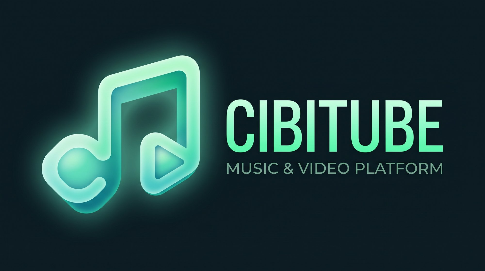
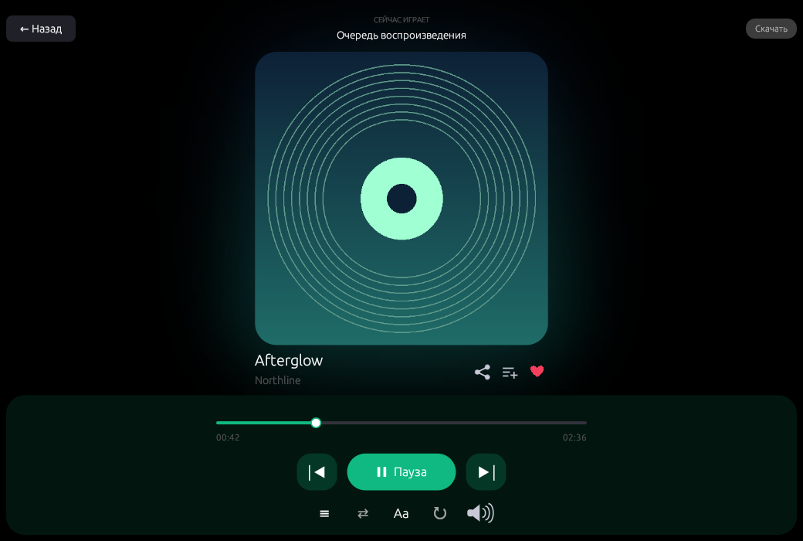
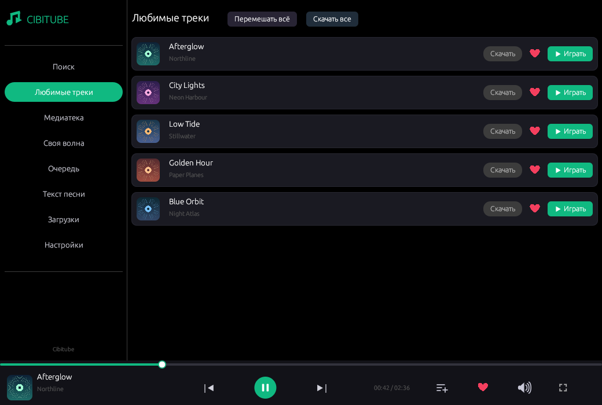
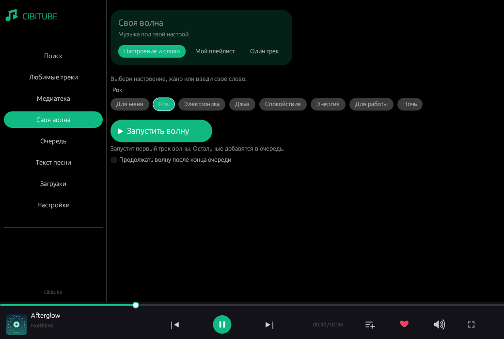

<p align="center">
  
</p>

<p align="center">
  <a href="https://www.rust-lang.org/">
    
  </a>
  <a href="https://github.com/emilk/egui">
    
  </a>
  <a href="https://mpv.io/">
    
  </a>
  <a href="https://github.com/Cibitka/Cibitube/releases">
    
  </a>
  <a href="https://github.com/Cibitka/Cibitube/releases/latest">
    
  </a>
  <a href="https://boosty.to/zch_cibitka/donate">
    
  </a>
  <a href="LICENSE">
    
  </a>
</p>

<p align="center">
  <a href="README.md"><b>🇬🇧 Read in English (README.md)</b></a> &nbsp;•&nbsp; <b>Русский</b> &nbsp;•&nbsp; <a href="docs/GOOGLE_DRIVE_SYNC_SETUP.md"><b>☁️ Настройка Google Диска</b></a> &nbsp;•&nbsp; <a href="https://github.com/Cibitka/Cibitube/releases/latest"><b>📥 Релизы</b></a>
</p>

---

# Cibitube — Нативный YouTube Music плеер для ПК

**Cibitube** — быстрый и легковесный клиент YouTube Music на чистом **Rust + egui + MPV + yt-dlp**. Запускается моментально и потребляет ~30 МБ оперативной памяти вместо 500+ МБ у Electron-плееров.

Отдельное приложение для **Android** находится в разработке. В его оформлении **Cibitube AMOLED Emerald** использованы идеи дизайна [Metrolist](https://github.com/2096-764/metrolist).

### ✨ Возможности
- ⚡ **Легковесность и скорость**: Нативный GUI на Rust 2021 + egui/eframe 0.30 с прямым управлением через сокет MPV IPC.
- 🔄 **Синхронизация ПК ↔ Android**: Бесплатная синхронизация очереди и секунды трека через `cibitube_sync_state.json` на вашем Google Диске.
- 🖼️ **Умный загрузчик**: Скачивание треков с опциями вшивания тегов, сохранения обложек `.jpg` и скачивания караоке-текстов `.lrc` из LRCLIB.
- 🌐 **Двуязычный интерфейс**: Переключение между русским и английским в один клик.
- ⏱️ **Управление звуком**: Таймер сна (15/30/45/60 мин), скорость и тональность (0.5x–2.0x), громкость из настроек.
- 🛡️ **Безопасность**: Права доступа `0600` при создании файлов с куками, атомарное сохранение через временный файл, создание бэкапа `settings.json.bak-<timestamp>` при повреждении.

---

### Скриншоты



<p align="center">
  
  
</p>

На экранах показаны тестовые треки и обложки.

---

### 📦 Зависимости

Для работы десктопной версии Cibitube необходимы:
- `mpv` (с поддержкой IPC)
- `yt-dlp`
- `ffmpeg` (*обязателен для извлечения аудио, вшивания обложек и метаданных*)

#### Ubuntu / Debian:
```bash
sudo apt update
sudo apt install mpv yt-dlp ffmpeg libasound2-dev libssl-dev pkg-config
```

#### Arch Linux:
```bash
sudo pacman -S mpv yt-dlp ffmpeg alsa-lib openssl
```

#### Fedora:
```bash
sudo dnf install mpv yt-dlp ffmpeg alsa-lib-devel openssl-devel
```

---

### 🔨 Сборка из исходников

```bash
git clone https://github.com/Cibitka/Cibitube.git
cd Cibitube
cargo build --release --locked
```

Собранный исполняемый файл находится в `target/release/cibitube`.
Установка в директорию пользователя:
```bash
install -Dm755 target/release/cibitube ~/.local/bin/cibitube
```

### ⚙️ Файлы конфигурации

Настройки и сохраненные данные авторизации располагаются по путям:
- Linux: `~/.local/share/cibitube/settings.json`

Права доступа `0600` устанавливаются сразу при создании. При ошибке парсинга файл не затирается, а сохраняется в бэкап (`settings.json.bak-<метка_времени>`).

---

### ☁️ Синхронизация между устройствами

Cibitube сохраняет позицию воспроизведения и очередь в файл `Cibitube-Sync/cibitube_sync_state.json` на вашем личном Google Диске.

Подробная инструкция: [docs/GOOGLE_DRIVE_SYNC_SETUP.md](docs/GOOGLE_DRIVE_SYNC_SETUP.md).

---

### ☕ Поддержать автора

Проект Cibitube полностью бесплатен. Вы можете добровольно поддержать развитие плеера:
- **Boosty (Карты РФ, МИР, СБП, зарубежные карты)**: [https://boosty.to/zch_cibitka/donate](https://boosty.to/zch_cibitka/donate)
- **USDT (сеть TON) / TON**: `UQDTl3ZXiUqMwQG-pWw3W2OvphGb9jRUGv6Wmsn1ZBOHV8NO`

---

### 📄 Лицензия

Десктопная версия распространяется под лицензией [MIT](LICENSE).

